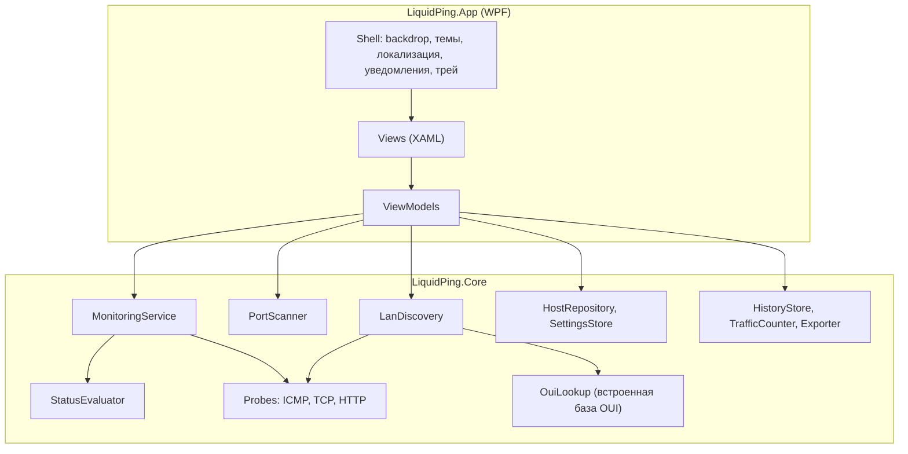
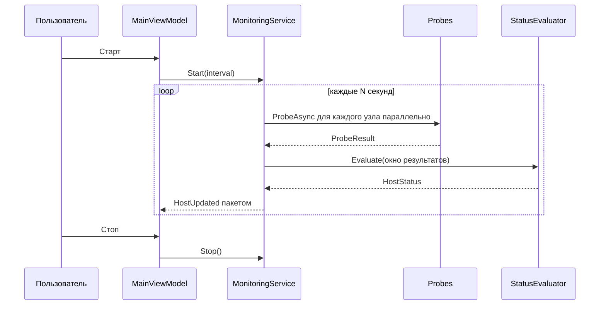
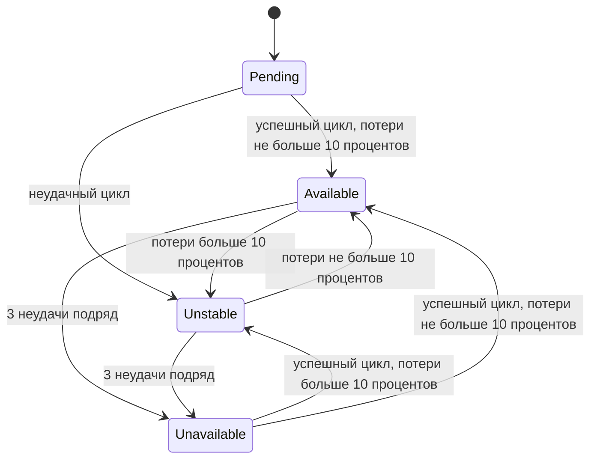

# Описание дизайна программного обеспечения

Для LiquidPing — сетевого сканера и ping-монитора

Версия 0.2

Подготовил Тарахович Лев Сергеевич

Белорусский Государственный Университет Информатики и Радиоэлектроники, кафедра ЭВМ

2026-10-28

## Оглавление

* [1. Введение](#1-введение)
  * [1.1 Назначение документа](#11-назначение-документа)
  * [1.2 Область применения](#12-область-применения)
  * [1.3 Определения, акронимы и сокращения](#13-определения-акронимы-и-сокращения)
  * [1.4 Ссылки](#14-ссылки)
  * [1.5 Обзор документа](#15-обзор-документа)
* [2. Обзор дизайна](#2-обзор-дизайна)
  * [2.1 Задачи стейкхолдеров](#21-задачи-стейкхолдеров)
  * [2.2 Выбранные точки зрения](#22-выбранные-точки-зрения)
* [3. Проектные представления](#3-проектные-представления)
* [4. Решения](#4-решения)
* [5. Приложения](#5-приложения)
  * [5.1 Priority scale](#51-priority-scale)
  * [5.2 System requirements](#52-system-requirements)
  * [5.3 Трассируемость SRS → системные требования](#53-трассируемость-srs--системные-требования)
  * [5.4 Открытые вопросы](#54-открытые-вопросы)

## История изменений

| Name           | Date       | Reason For Changes                                                                                                                                               | Version |
|----------------|------------|------------------------------------------------------------------------------------------------------------------------------------------------------------------|---------|
| Тарахович Л.С. | 2026-10-28 | Первая версия SDD на основе SRS 1.1                                                                                                                              | 0.1     |
| Тарахович Л.С. | 2026-10-26 | Актуализация архитектуры по итогам согласования: добавлены SYS-FUNC-015, 016, системный трей SYS-FUNC-014 возвращён в план, закрыты открытые вопросы 1, 2, 3 и 6 | 0.2     |

---

## 1. Введение

Документ описывает проектное решение для приложения LiquidPing: из каких частей оно состоит, как они взаимодействуют и почему выбраны именно такие решения. Раздел 2 задаёт задачи стейкхолдеров и точки зрения, раздел 3 содержит проектные представления, раздел 4 — ссылки на архитектурные решения (ADR), раздел 5 — системные требования с приоритетами и трассируемость к SRS.

### 1.1 Назначение документа

SDD отвечает на вопрос **КАК** будут реализованы требования SRS. Документ предназначен для разработчика и архитектора (одно лицо в учебном проекте), для заказчика и преподавателя (проверка того, что каждое требование SRS покрыто дизайном) и для тех, кто будет сопровождать проект после публикации на GitHub. Связанные документы: [SRS](../srs/srs.md) (что должна делать система), [ADR](../adr/) (почему принято то или иное решение).

### 1.2 Область применения

Проектируется LiquidPing версии 1.0 — десктопное приложение для Windows 11 (x64), которое проверяет доступность узлов по ICMP, TCP и HTTP(S), сканирует TCP-порты и обнаруживает хосты в локальной сети, отображая результаты в интерфейсе в стиле liquid glass. Документ охватывает всё приложение целиком; серверной части и внешних сервисов у продукта нет. Границы продукта (Scope / Out-of-scope) определены в разделе 1.2 SRS и здесь не повторяются. Возможности связаны с бизнес-целями БЦ-1…БЦ-3 из SRS.

### 1.3 Определения, акронимы и сокращения

| Term                | Definition                                                                                                |
|---------------------|-----------------------------------------------------------------------------------------------------------|
| ADR                 | Architecture Decision Record — протокол архитектурного решения                                            |
| BCL                 | Base Class Library — стандартная библиотека классов .NET                                                  |
| Core                | Проект `LiquidPing.Core`: логика проверок и сканирования без зависимостей от WPF                          |
| DI                  | Dependency Injection — внедрение зависимостей                                                             |
| DWM                 | Desktop Window Manager — компонент Windows, отвечающий за композицию окон и эффекты размытия              |
| MVVM                | Model–View–ViewModel — шаблон разделения интерфейса и логики представления                                |
| OUI                 | Organizationally Unique Identifier — первые 3 байта MAC-адреса, идентифицирующие производителя устройства |
| SDD                 | Software Design Description — описание дизайна программного обеспечения                                   |
| SRS                 | Software Requirements Specification — спецификация требований к ПО                                        |
| TAP                 | Task-based Asynchronous Pattern — асинхронная модель .NET на основе `Task` и `async`/`await`              |
| Backdrop            | Системный фон окна (Mica, Acrylic), который рисует DWM                                                    |
| Пакетное обновление | Передача результатов в интерфейс группами через интервал, а не по одному                                  |

### 1.4 Ссылки

| Ссылка                                         | Тип         | Расположение                                                   |
|------------------------------------------------|-------------|----------------------------------------------------------------|
| SRS LiquidPing, версия 1.1                     | Нормативная | [../srs/srs.md](../srs/srs.md)                                 |
| Модель интерфейса (SysML v2)                   | Нормативная | [../srs/gui-model.sysml](../srs/gui-model.sysml)               |
| Диаграмма навигации                            | Справочная  | [../srs/img/gui-navigation.png](../srs/img/gui-navigation.png) |
| Протоколы архитектурных решений                | Нормативная | [../adr/](../adr/)                                             |
| ISO/IEC/IEEE 42010 — Architecture description  | Справочная  | https://www.iso.org/standard/74393.html                        |
| MADR — Markdown Architectural Decision Records | Справочная  | https://adr.github.io/madr/                                    |
| Шаблон SDD кафедры ЭВМ БГУИР                   | Нормативная | https://github.com/BSUIR-SDLC/SDLC                             |

### 1.5 Обзор документа

Раздел 2 связывает стейкхолдеров и их задачи с точками зрения. В разделе 3 каждое проектное представление имеет идентификатор вида `NNN-название`, указывает точку зрения и ссылки на реализуемые требования SRS. В разделе 4 перечислены принятые решения со ссылками на полные ADR. В разделе 5 приведены системные требования (на английском языке) с приоритетами от 10 до 50 и матрица трассируемости. Изменения документа фиксируются в таблице истории изменений.

---

## 2. Обзор дизайна

Приложение построено как два проекта: библиотека `LiquidPing.Core` с логикой проверок, сканирования, оценки статуса и хранения, и WPF-приложение `LiquidPing.App` с интерфейсом по шаблону MVVM. Проверки выполняются асинхронно средствами BCL без прав администратора, результаты передаются в интерфейс пакетами, а эффект liquid glass достигается системным фоном окна Windows 11 и полупрозрачными панелями.

### 2.1 Задачи стейкхолдеров

| ID | Задача                                                                                      | Стейкхолдер                            | Адресуется представлениями       |
|----|---------------------------------------------------------------------------------------------|----------------------------------------|----------------------------------|
| C1 | Быстро и понятно увидеть состояние узлов, найти порты и устройства сети                     | Пользователь, начинающий администратор | 001, 006, 007, 008               |
| C2 | Отзывчивый интерфейс и ограниченное потребление памяти (не более 1 ГБ)                      | Пользователь                           | 009, 010, 011                    |
| C3 | Безопасность и приватность: без прав администратора, без телеметрии, скан только по запросу | Пользователь                           | 001, 005, 007                    |
| C4 | Стиль liquid glass, светлая и тёмная темы, русский и английский языки                       | Пользователь, заказчик                 | 002, 004, 013                    |
| C5 | Сопровождаемость и тестируемость, ясные границы между интерфейсом и логикой                 | Разработчик, сопровождающий            | 002, 003, 005, 011, 013          |
| C6 | Простая сборка, поставка и лицензирование                                                   | Сопровождающий, пользователи GitHub    | 012, 013                         |
| C7 | Прослеживаемость: каждое требование SRS покрыто дизайном и обосновано                       | Заказчик, преподаватель                | все представления, разделы 4 и 5 |
| C8 | Устойчивость к сетевым ошибкам и повреждённым данным                                        | Пользователь                           | 004, 007, 008                    |

### 2.2 Выбранные точки зрения

Выбраны 13 точек зрения из 15 возможных. Не выбраны: **Physical** (у проекта нет собственной аппаратной инфраструктуры, приложение работает на обычном ПК) и **Structure** (внутренняя организация компонентов достаточно описана в Composition и Logical).

#### 2.2.1 Контекст

Выбрана. Адресует C1, C3. Язык: структурированное текстовое описание. Представление: `001-context`.

#### 2.2.2 Композиция

Выбрана. Адресует C4, C5. Язык: диаграмма компонентов (Mermaid). Представление: `002-composition`.

#### 2.2.3 Логическое представление

Выбрана. Адресует C5. Язык: таблица основных типов. Представление: `003-logical`.

#### 2.2.4 Физическое представление

Не выбрана (см. выше).

#### 2.2.5 Структура

Не выбрана (см. выше).

#### 2.2.6 Зависимости

Выбрана. Адресует C5, C6. Язык: таблица зависимостей. Представление: `013-dependency`.

#### 2.2.7 Информация

Выбрана. Адресует C4, C8. Язык: таблицы и примеры JSON. Представление: `004-information`.

#### 2.2.8 Интерфейс

Выбрана. Адресует C3, C5. Язык: сигнатуры интерфейсов C#. Представление: `005-interface`.

#### 2.2.9 Взаимодействие

Выбрана. Адресует C1. Язык: диаграмма последовательности UML (Mermaid). Представление: `006-interaction`.

#### 2.2.10 Алгоритм

Выбрана. Адресует C1, C2, C3, C8. Язык: псевдокод и таблицы решений. Представление: `007-algorithm`.

#### 2.2.11 Динамика состояний

Выбрана. Адресует C1, C8. Язык: диаграмма состояний UML (Mermaid) и конечный автомат навигации SysML v2. Представление: `008-state-dynamics`.

#### 2.2.12 Параллелизм

Выбрана. Адресует C2. Язык: таблица правил. Представление: `009-concurrency`.

#### 2.2.13 Паттерны

Выбрана. Адресует C5. Язык: таблица паттернов. Представление: `011-patterns`.

#### 2.2.14 Развёртывание

Выбрана. Адресует C6. Язык: текстовое описание. Представление: `012-deployment`.

#### 2.2.15 Ресурсы

Выбрана. Адресует C2. Язык: таблица распределения ресурсов. Представление: `010-resources`.

---

## 3. Проектные представления

### 001-context

- **ID**: 001-context
- **Title**: Контекст системы
- **Viewpoint**: Контекст
- **Representation**: система рассматривается как «чёрный ящик» на компьютере пользователя. Окружение:
  - **Пользователь** запускает мониторинг, сканирование портов и обнаружение хостов, управляет списком узлов и настройками (варианты использования `MonitorHosts`, `ScanPorts`, `DiscoverLanHosts`, `ManageHosts`, см. [gui-model.sysml](../srs/gui-model.sysml)).
  - **Сетевой стек и DNS-резолвер Windows** — единственный канал во внешнюю сеть: проверки узлов в интернете и устройств локальной сети.
  - **Файловая система** (`%AppData%\LiquidPing`) — настройки, список узлов, журнал.
  - **Центр уведомлений Windows** — уведомления о смене статуса узла.

  Приложение обращается только к узлам из списка пользователя и к адресам подсетей собственных сетевых адаптеров. Других внешних систем нет.
- **More Information**: реализует REQ-FUNC-001…022, REQ-INT-006, REQ-INT-007, REQ-SEC-002, REQ-SEC-003; решение ADR-0005.

### 002-composition

- **ID**: 002-composition
- **Title**: Состав приложения
- **Viewpoint**: Композиция
- **Representation**:



Решение разбивает код на два проекта, чтобы сетевая логика не зависела от WPF и тестировалась отдельно (ADR-0003).
- **More Information**: реализует REQ-SEC-001, REQ-FUNC-009, раздел 3.5.4 и 3.5.5 SRS; модульные тесты — проект `LiquidPing.Core.Tests`.

### 003-logical

- **ID**: 003-logical
- **Title**: Основные типы Core
- **Viewpoint**: Логическое представление
- **Representation**:

| Тип                                             | Роль                                                                                   | Связи                                          |
|-------------------------------------------------|----------------------------------------------------------------------------------------|------------------------------------------------|
| `Host`                                          | Узел: имя, адрес, порт TCP, URL, включённые проверки                                   | Используется всеми сервисами                   |
| `IProbe` и `IcmpProbe`, `TcpProbe`, `HttpProbe` | Одна проверка узла; возвращает `ProbeResult`                                           | Strategy; вызывается `MonitoringService`       |
| `ProbeResult`                                   | Успех, задержка, тип ошибки, переданные и полученные байты                             | Результат `IProbe`                             |
| `StatusEvaluator`, `HostStatus`                 | Оценка статуса по окну из 20 циклов; `Pending`, `Available`, `Unstable`, `Unavailable` | Вызывается `MonitoringService`                 |
| `MonitoringService`                             | Циклы проверок, запуск и остановка, событие `HostUpdated`                              | Использует `IProbe`, `StatusEvaluator`         |
| `PortScanner`                                   | Сканирование портов с прогрессом и отменой                                             | Возвращает `ScanResult`                        |
| `LanDiscovery`, `LanHostInfo`                   | Обнаружение хостов подсети; запись о найденном хосте                                   | Использует `IProbe`, ARP-таблицу, `IOuiLookup` |
| `IOuiLookup`, `OuiVendorResolver`               | Определение производителя по MAC-адресу из встроенной базы OUI                         | Используется `LanDiscovery`                    |
| `IHostRepository`, `ISettingsStore`             | Хранение узлов и настроек в JSON                                                       | Используются ViewModel                         |

Сигнатуры контрактов приведены в `005-interface`.
- **More Information**: реализует REQ-FUNC-003…012, REQ-FUNC-020…022; шаблон Strategy для проверок (см. 011-patterns).

### 004-information

- **ID**: 004-information
- **Title**: Данные приложения
- **Viewpoint**: Информация
- **Representation**: постоянные данные хранятся в каталоге `%AppData%\LiquidPing\` в формате JSON (ADR-0006). История и счётчики трафика хранятся только в памяти за сеанс.

| Файл             | Содержимое                                  | Когда читается и пишется                           |
|------------------|---------------------------------------------|----------------------------------------------------|
| `hosts.json`     | список узлов пользователя                   | чтение при запуске; запись при изменении списка    |
| `settings.json`  | настройки приложения                        | чтение при запуске; запись при изменении настроек  |
| `logs/*.log`     | журнал событий и ошибок с ротацией          | запись во время работы                             |

Пример `hosts.json`:

```json
{
  "version": 1,
  "hosts": [
    {
      "id": "6f3c1d0a-2b7e-4c59-9a41-0d5e8f7b1c22",
      "name": "Google",
      "address": "google.com",
      "tcpPort": 443,
      "httpUrl": "https://google.com/",
      "useIcmp": true,
      "useTcp": true,
      "useHttp": true
    }
  ]
}
```

Поля `settings.json` и значения по умолчанию:

| Поле                   | Значение по умолчанию   | Допустимые значения       | Источник требования |
|------------------------|-------------------------|---------------------------|---------------------|
| `intervalSeconds`      | 5                       | 1–60                      | REQ-FUNC-008        |
| `icmpTimeoutMs`        | 2000                    | 200–10000                 | REQ-FUNC-017        |
| `tcpTimeoutMs`         | 1000                    | 200–10000                 | REQ-FUNC-017        |
| `httpTimeoutMs`        | 5000                    | 500–30000                 | REQ-FUNC-017        |
| `portTimeoutMs`        | 1000                    | 200–5000                  | REQ-PERF-003        |
| `chartWindowMinutes`   | 10                      | 1–60                      | REQ-FUNC-014        |
| `theme`                | `system`                | `system`, `light`, `dark` | REQ-INT-002         |
| `language`             | язык ОС (`ru` или `en`) | `ru`, `en`                | REQ-INT-008         |
| `notificationsEnabled` | true                    | true, false               | REQ-FUNC-016        |
| `trayEnabled`          | false                   | true, false               | REQ-FUNC-019        |

База OUI-префиксов не относится к данным пользователя: она поставляется как сжатый встроенный ресурс сборки `LiquidPing.Core` (ADR-0006).

Файлы записываются через временный файл с последующей заменой, чтобы сбой записи не повредил рабочую копию. При повреждении файл переименовывается в `*.bak`, и применяются значения по умолчанию (REQ-REL-002).
- **More Information**: реализует REQ-FUNC-001, 002, 017, REQ-REL-002, REQ-OBS-001.

### 005-interface

- **ID**: 005-interface
- **Title**: Внутренние контракты Core
- **Viewpoint**: Интерфейс
- **Representation**:

```csharp
public interface IProbe
{
    ProbeKind Kind { get; }
    Task<ProbeResult> ProbeAsync(Host host, TimeSpan timeout, CancellationToken ct);
}

public interface IMonitoringService
{
    event EventHandler<HostUpdatedEventArgs> HostUpdated;
    void Start(TimeSpan interval);
    void Stop();
    Task CheckOnceAsync(CancellationToken ct);
}

public interface IPortScanner
{
    Task<ScanResult> ScanAsync(Host host, PortSet ports, IProgress<ScanProgress> progress, CancellationToken ct);
}

public record LanHostInfo(
    IPAddress Address,
    TimeSpan? Latency,
    string? HostName,
    PhysicalAddress? MacAddress,
    string? Vendor
);

public interface IOuiLookup
{
    string? ResolveVendor(PhysicalAddress macAddress);
}

public interface ILanDiscovery
{
    Task<IReadOnlyList<LanHostInfo>> DiscoverAsync(IProgress<ScanProgress> progress, CancellationToken ct);
}

public interface IHostRepository
{
    Task<IReadOnlyList<Host>> LoadAsync(CancellationToken ct);
    Task SaveAsync(IReadOnlyList<Host> hosts, CancellationToken ct);
}

public interface ISettingsStore
{
    Task<AppSettings> LoadAsync(CancellationToken ct);
    Task SaveAsync(AppSettings settings, CancellationToken ct);
}
```

Каждая длительная операция принимает `CancellationToken` и сообщает о прогрессе через `IProgress<T>`, поэтому интерфейс может отменять скан и показывать прогресс (REQ-FUNC-012, 021). Внешние интерфейсы приложения -- системные API: `System.Net.NetworkInformation.Ping`, `Socket`/`TcpClient`, `HttpClient`, `NetworkInterface`, вызов `GetIpNetTable` для ARP-таблицы, `DwmSetWindowAttribute` для системного фона окна.
- **More Information**: реализует REQ-INT-006, REQ-FUNC-012, 021, 022; решения ADR-0002, ADR-0005.

### 006-interaction

- **ID**: 006-interaction
- **Title**: Цикл мониторинга и сканирование портов
- **Viewpoint**: Взаимодействие
- **Representation**:

Цикл мониторинга:



Сканирование портов происходит аналогично: `PortsViewModel` вызывает `PortScanner.ScanAsync` с набором портов, прогрессом и `CancellationToken`; при нажатии «Отмена» токен отменяется, сканер прекращает запуск новых соединений и возвращает уже собранный частичный результат (алгоритм — в `007-algorithm`).

- **More Information**: реализует REQ-FUNC-008…012, REQ-FUNC-013; пошаговая навигация описана в `008-state-dynamics`.

### 007-algorithm

- **ID**: 007-algorithm
- **Title**: Алгоритмы оценки статуса, сканирования портов и обнаружения хостов
- **Viewpoint**: Алгоритм
- **Representation**:

**Оценка статуса узла** (`StatusEvaluator`, REQ-FUNC-006, 007). Цикл проверки считается успешным, если успешна хотя бы одна включённая проверка (ICMP, TCP или HTTP). Окно хранит результаты последних 20 циклов.

```
loss = failedCycles(window) / count(window) * 100
if consecutiveFailures >= 3: Unavailable
else if loss > 10: Unstable
else if count(window) == 0: Pending
else: Available
```

**Сканирование портов** (`PortScanner`, REQ-FUNC-010…012, REQ-PERF-003):

```
for port in ports:
    acquire semaphore(limit = 100)
    start TCP connect with timeout = portTimeoutMs
    on connected: state = Open
    on connection refused: state = Closed
    on timeout or unreachable: state = Filtered
    release semaphore
    report progress
on cancel: stop starting new connects, return collected results
```

Оценка времени для набора 1–1024 при лимите 100 и тайм-ауте 1 с: не более `]1024 / 100[ * 1 с` = 11 с в худшем случае, что укладывается в REQ-PERF-003 (не более 30 с).

**Обнаружение хостов в локальной сети** (`LanDiscovery`, REQ-FUNC-020, 021, 022):

```
for adapter in network interfaces where status = Up and not loopback:
    for address in adapter IPv4 unicast addresses:
        subnet = address and mask
        if prefixLength < 22: report "subnet too large", skip
        targets = all addresses of subnet except network and broadcast
        for target in targets with semaphore(limit = 64):
            ping with timeout = 1 s
            on reply: record IP and latency

        read ARP table via GetIpNetTable:
            for each entry in ARP table matching subnet:
                if entry not in recorded IPs:
                    record IP as active (silent host), latency = null
                attach MAC address to record
                lookup Vendor = OuiLookup.ResolveVendor(MAC)

        resolve host names by reverse DNS in parallel, timeout = 1 s
report progress after each target
```

Для подсети /24 при лимите 64 и тайм-ауте 1 с время не превышает `ceil(254 / 64) * 1 с` ≈ 4 с в худшем случае, при требовании не более 30 с (REQ-FUNC-021).

- **More Information**: устройства, не отвечающие на ICMP («тихие» хосты), обнаруживаются по записям ARP-таблицы и показываются без задержки (SYS-FUNC-015). Производитель определяется локально по встроенной базе OUI, без сетевых запросов. Выбор способа выполнения проверок — ADR-0005, хранения базы OUI — ADR-0006.

### 008-state-dynamics

- **ID**: 008-state-dynamics
- **Title**: Состояния узла, сеанса мониторинга и навигации
- **Viewpoint**: Динамика состояний
- **Representation**:

Статус узла:



Сеанс мониторинга имеет два состояния: `Idle` (до `Start` и после `Stop`) и `Running` (после `Start`); разовая проверка `CheckOnce` выполняется в `Idle` без смены состояния.

Навигация между экранами описана конечным автоматом на SysML v2: [gui-navigation.png](../srs/img/gui-navigation.png), исходный код — [gui-model.sysml](../srs/gui-model.sysml). Путь до просмотра портов состоит из двух событий: `SelectHost`, затем `ShowPorts`.
- **More Information**: реализует REQ-FUNC-006, 008, 013, REQ-REL-003. Состояние `Pending` — официальное стартовое состояние узла до завершения первого цикла проверок; отображается индикатором ожидания (REQ-FUNC-006, SYS-FUNC-003).

### 009-concurrency

- **ID**: 009-concurrency
- **Title**: Модель параллелизма
- **Viewpoint**: Параллелизм
- **Representation**:

Поток данных: `PeriodicTimer` запускает цикл, на каждый узел создаётся задача, число одновременных узлов ограничено `SemaphoreSlim`; результаты кладутся в `Channel` и забираются интерфейсом пакетом каждые 100–250 мс.

| Элемент              | Правило                                                                                                   |
|----------------------|-----------------------------------------------------------------------------------------------------------|
| UI-поток             | Не выполняет ввод-вывод и блокирующие вызовы; только обновляет привязанные коллекции                      |
| Цикл мониторинга     | Запускается `PeriodicTimer`; если предыдущий цикл не завершился, следующий не накладывается               |
| Лимит параллелизма   | Узлы: 64 одновременно; порты: 100 одновременно; обнаружение сети: 64 одновременно                         |
| Общее состояние      | Окна результатов и статусы хранятся в потокобезопасных структурах, изменяются только сервисом мониторинга |
| Отмена               | Каждая операция получает свой `CancellationTokenSource`; отмена прекращает запуск новых проверок за ≤ 2 с |
| Передача в интерфейс | Результаты кладутся в `Channel`, интерфейс забирает их пакетом по таймеру                                 |

- **More Information**: реализует REQ-FUNC-009, REQ-FUNC-012, 021, REQ-PERF-002; решение ADR-0004.

### 010-resources

- **ID**: 010-resources
- **Title**: Бюджет ресурсов
- **Viewpoint**: Ресурсы
- **Representation**:

| Ресурс                      | Ограничение в дизайне                                                                                        | Оценка                                                              |
|-----------------------------|--------------------------------------------------------------------------------------------------------------|---------------------------------------------------------------------|
| Память: история задержек    | Кольцевой буфер не более 1000 точек на узел                                                                  | 1000 точек × 50 узлов × 24 байта ≈ 1,2 МБ                           |
| Память: списки в интерфейсе | Виртуализация списков и таблиц результатов                                                                   | Ограничивается видимыми элементами                                  |
| Память: общий лимит         | Нет неограниченных очередей и кэшей; результаты сканирования хранятся только последнего запуска              | Контролируется замером Working Set (REQ-PERF-001, не более 1024 МБ) |
| Сокеты и потоки             | Лимиты параллелизма из `009-concurrency`; задачи вместо выделенных потоков                                   | Не более 100 одновременных соединений при скане                     |
| База OUI                    | Сжатый встроенный ресурс; загружается лениво при первом обнаружении хостов, ключ — первые 3 байта MAC-адреса | Без внешних файлов и обращений к диску при поиске                   |
| Диск                        | Журнал с ротацией                                                                                            | Не более 20 МБ (REQ-OBS-001)                                        |
| Время запуска               | Ленивая инициализация тяжёлых сервисов, загрузка данных асинхронно                                           | Не более 3 с (REQ-PERF-004)                                         |

- **More Information**: реализует REQ-PERF-001, 003, 004, REQ-OBS-001, REQ-FUNC-014. Замеры выполняются профилировщиком памяти и счётчиками процесса.

### 011-patterns

- **ID**: 011-patterns
- **Title**: Применяемые паттерны
- **Viewpoint**: Паттерны
- **Representation**:

| Паттерн              | Где применяется                               | Зачем                                                             |
|----------------------|-----------------------------------------------|-------------------------------------------------------------------|
| MVVM                 | Весь слой интерфейса                          | Отделить внешний вид от логики представления                      |
| Dependency Injection | Сборка сервисов при запуске                   | Подменять реализации в тестах и менять их без правки потребителей |
| Strategy             | `IProbe` и реализации ICMP, TCP, HTTP         | Добавлять проверки без изменения сервиса мониторинга              |
| Observer (события)   | `HostUpdated`, прогресс сканирования          | Развязать сервисы и интерфейс                                     |
| Repository           | `IHostRepository`, `ISettingsStore`           | Скрыть формат хранения                                            |
| Producer–Consumer    | `Channel` между проверками и интерфейсом      | Сгладить поток результатов и не перегружать UI-поток              |
| Options              | Строго типизированные настройки `AppSettings` | Единая точка доступа к конфигурации                               |

- **More Information**: решение ADR-0003, ADR-0004.

### 012-deployment

- **ID**: 012-deployment
- **Title**: Развёртывание
- **Viewpoint**: Развёртывание
- **Representation**:

Приложение работает на одном ПК под Windows 11 x64: исполняемый файл с библиотеками (переносимый архив) и данные в `%AppData%\LiquidPing` (`settings.json`, `hosts.json`, `logs`). Единственное внешнее взаимодействие — сеть: интернет и локальная сеть.

Поставка — переносимый архив self-contained для `win-x64`, публикуется в разделе Releases на GitHub. Сборка: `dotnet publish -c Release -r win-x64 --self-contained`. Установка сводится к распаковке; права администратора не нужны. Установщик в версию 1.0 не входит.
- **More Information**: реализует раздел 3.5.1, 3.5.2 SRS, REQ-SEC-001, REQ-COMP-001; решение ADR-0007.

### 013-dependency

- **ID**: 013-dependency
- **Title**: Зависимости проектов и пакетов
- **Viewpoint**: Зависимости
- **Representation**:

| Проект или пакет        | Зависит от                                                                                             | Лицензия                  |
|-------------------------|--------------------------------------------------------------------------------------------------------|---------------------------|
| `LiquidPing.App`        | `LiquidPing.Core`, CommunityToolkit.Mvvm, Microsoft.Extensions.DependencyInjection, Serilog.Sinks.File | MIT, MIT, MIT, Apache-2.0 |
| `LiquidPing.Core`       | .NET BCL (`System.Net`, `System.Text.Json`), Microsoft.Extensions.Logging.Abstractions                 | MIT                       |
| `LiquidPing.Core.Tests` | `LiquidPing.Core`                                                                                      | —                         |

Правило направления зависимостей: `App` зависит от `Core`, обратной зависимости нет, `Core` не ссылается на сборки WPF. Все сторонние пакеты должны иметь лицензию, совместимую с MIT (REQ-COMP-001). Библиотеки для графика и системных уведомлений выбираются на этапе реализации и добавляются в этот список (см. 5.4).
- **More Information**: реализует REQ-COMP-001, разделы 3.5.4, 3.5.5 SRS; решение ADR-0003.

---

## 4. Решения

Значимые решения оформлены отдельными протоколами по шаблону MADR в каталоге [docs/adr](../adr/): одно решение — один файл.

| ID       | Title                                                                                | Status   | Outcome                                                                                                         | Представления |
|----------|--------------------------------------------------------------------------------------|----------|-----------------------------------------------------------------------------------------------------------------|---------------|
| ADR-0001 | [UI-платформа: WPF на текущей LTS-версии .NET](../adr/0001-wpf-on-dotnet-lts.md)     | accepted | WPF на `net10.0-windows`, потому что это требование заказчика и ограничение SRS 2.3                             | 002, 013      |
| ADR-0002 | [Реализация эффекта liquid glass](../adr/0002-liquid-glass-via-dwm-backdrop.md)      | accepted | Системный backdrop окна через DWM и полупрозрачные панели                                                       | 002, 005      |
| ADR-0003 | [Архитектура: два проекта, MVVM и DI](../adr/0003-layered-mvvm-with-core-library.md) | accepted | `LiquidPing.Core` + `LiquidPing.App`, MVVM, внедрение зависимостей                                              | 002, 011, 013 |
| ADR-0004 | [Модель параллелизма](../adr/0004-async-concurrency-model.md)                        | accepted | `async`/`await`, `PeriodicTimer`, `SemaphoreSlim`, `Channel`, пакетное обновление интерфейса                    | 006, 009      |
| ADR-0005 | [Способ выполнения проверок и сканирования](../adr/0005-bcl-network-probing.md)      | accepted | Только средства BCL и ARP-таблица Windows (в том числе для «тихих» хостов), без драйверов и прав администратора | 001, 005, 007 |
| ADR-0006 | [Хранение данных: JSON в AppData](../adr/0006-json-persistence-in-appdata.md)        | accepted | JSON-файлы с атомарной записью; история только в памяти; база OUI — встроенный сжатый ресурс                    | 004           |
| ADR-0007 | [Формат поставки](../adr/0007-portable-self-contained-distribution.md)               | accepted | Переносимый self-contained архив для `win-x64`                                                                  | 012           |

---

## 5. Приложения

### 5.1 Priority scale

Priority is set by business value for the customer, not by implementation order. The order of implementation is defined later by the iteration plan, which also takes dependencies between functions into account. Scale: **10 = highest, 50 = lowest**.

| Priority | Meaning                                                                                                                       | Typical SRS priority |
|----------|-------------------------------------------------------------------------------------------------------------------------------|----------------------|
| 10       | Critical: the product is useless or unacceptable without it; mandatory from customer/teacher; high risk to be validated first | Must                 |
| 20       | High: required for release 1.0, but works only on top of priority 10 items                                                    | Must                 |
| 30       | Medium: valuable, planned for release 1.1                                                                                     | Should               |
| 40       | Low: useful, can be postponed without hurting core value                                                                      | Should / Could       |
| 50       | Minimal: nice to have, only if time remains                                                                                   | Could                |

### 5.2 System requirements

IDs have the form `SYS-FUNC-NNN` (functional) and `SYS-NFR-NNN` (non-functional). Each requirement is derived from SRS items and mapped to a design view from section 3.

| ID           | Type | System requirement                                                                                                                                                                                                                                                  | Derived from (SRS)                     | Design view | Priority |
|--------------|------|---------------------------------------------------------------------------------------------------------------------------------------------------------------------------------------------------------------------------------------------------------------------|----------------------------------------|-------------|----------|
| SYS-FUNC-001 | F    | The system shall keep a host registry (name, address, probe settings), load the 6 default hosts on first start, and persist add/edit/delete changes between runs.                                                                                                   | REQ-FUNC-001, 002                      | 003, 004    | 10       |
| SYS-FUNC-002 | F    | The system shall provide ICMP, TCP and HTTP(S) probes behind one `IProbe` contract, each returning success, latency, error kind and bytes transferred, with a per-probe timeout and cancellation.                                                                   | REQ-FUNC-003, 004, 005, REQ-INT-006    | 003, 005    | 10       |
| SYS-FUNC-003 | F    | The system shall evaluate host status (Pending / Available / Unstable / Unavailable) over a sliding window of the last 20 probe cycles, with Pending as the initial state until the first cycle completes, and expose status, latency, packet loss and resolved IP. | REQ-FUNC-006, 007                      | 007, 008    | 10       |
| SYS-FUNC-004 | F    | The system shall run probes for all hosts in parallel and asynchronously, support run-once and continuous modes with an interval of 1–60 s, and allow start/stop.                                                                                                   | REQ-FUNC-008, 009                      | 006, 009    | 10       |
| SYS-FUNC-005 | F    | The system shall scan TCP ports of a selected host on user request using presets (popular, 1–1024) or a custom range/list, with progress, cancellation and per-port state (open/closed/filtered).                                                                   | REQ-FUNC-010, 011, 012                 | 006, 007    | 20       |
| SYS-FUNC-006 | F    | The system shall discover hosts in IPv4 subnets of local network adapters on user request (at most 1024 addresses per subnet), reporting IP, latency, host name and MAC when available, with progress and cancellation.                                             | REQ-FUNC-020, 021                      | 007, 009    | 10       |
| SYS-FUNC-007 | F    | The system shall implement the screen set and the navigation state machine from the GUI model so that the ports of any host are reachable within 2 clicks from the main screen.                                                                                     | REQ-FUNC-013, REQ-INT-004              | 008         | 10       |
| SYS-FUNC-008 | F    | The system shall provide a typed settings service (interval, timeouts, theme, language, notifications) persisted as JSON and applied at runtime without restart.                                                                                                    | REQ-FUNC-017                           | 004         | 20       |
| SYS-FUNC-009 | F    | The system shall support Russian and English UI strings from resources, defaulting to the OS language and switching at runtime.                                                                                                                                     | REQ-INT-008                            | 002, 004    | 30       |
| SYS-FUNC-010 | F    | The system shall keep a per-host latency history in a ring buffer (at most 1000 points) and render it as a chart for the last N minutes (default 10).                                                                                                               | REQ-FUNC-014                           | 004, 010    | 30       |
| SYS-FUNC-011 | F    | The system shall count bytes sent and received by probes per host and in total for the session.                                                                                                                                                                     | REQ-FUNC-015                           | 003         | 40       |
| SYS-FUNC-012 | F    | The system shall raise a Windows notification once per status change between Available and Unavailable, and allow disabling it in settings.                                                                                                                         | REQ-FUNC-016, REQ-INT-007              | 002, 008    | 30       |
| SYS-FUNC-013 | F    | The system shall export results and history to CSV or JSON.                                                                                                                                                                                                         | REQ-FUNC-018                           | 002         | 40       |
| SYS-FUNC-014 | F    | The system shall minimize to the system tray and continue monitoring.                                                                                                                                                                                               | REQ-FUNC-019                           | 002         | 30       |
| SYS-FUNC-015 | F    | The system shall include silent ARP table entries in LAN discovery results and resolve the device manufacturer (vendor) from a local embedded MAC OUI prefix database.                                                                                              | REQ-FUNC-020, 022                      | 003, 007    | 20       |
| SYS-FUNC-016 | F    | The system shall allow adding any discovered local network host directly to HostRepository in a single click via addToMonitoringButton without creating duplicates.                                                                                                 | REQ-FUNC-002, 022                      | 005, 008    | 20       |
| SYS-NFR-001  | NF   | The process working set shall not exceed 1024 MB under the reference load (50 hosts, 5 s interval, 30 minutes, one 1–1024 port scan); unbounded queues and caches are forbidden.                                                                                    | REQ-PERF-001                           | 010         | 10       |
| SYS-NFR-002  | NF   | No I/O or blocking call shall run on the UI thread; results shall reach the UI in batches, keeping click response ≤ 100 ms.                                                                                                                                         | REQ-PERF-002                           | 009         | 10       |
| SYS-NFR-003  | NF   | Windows shall be drawn with a system backdrop and translucent panels (liquid glass), with an opaque fallback when effects are off and text contrast ≥ 4.5:1.                                                                                                        | REQ-INT-001, 003, 005                  | 002         | 20       |
| SYS-NFR-004  | NF   | Light and dark themes shall be switchable without restart and follow the system theme on first run.                                                                                                                                                                 | REQ-INT-002                            | 002, 004    | 20       |
| SYS-NFR-005  | NF   | The application shall run as a standard user, use only OS network APIs (no drivers, no raw sockets), perform scans only on explicit user action and send no telemetry.                                                                                              | REQ-SEC-001, 002, 003                  | 001, 007    | 10       |
| SYS-NFR-006  | NF   | All user input (host names, addresses, ports, intervals) shall be validated and rejected with a message when invalid.                                                                                                                                               | REQ-SEC-004                            | 005         | 10       |
| SYS-NFR-007  | NF   | Network errors (timeout, DNS failure, refused connection) shall be mapped to error kinds, shown to the user and never crash the application.                                                                                                                        | REQ-REL-001                            | 003, 008    | 10       |
| SYS-NFR-008  | NF   | A corrupted settings or hosts file shall be renamed to `.bak` and defaults loaded; a missing network connection shall be reported with a banner.                                                                                                                    | REQ-REL-002, 003                       | 004, 008    | 30       |
| SYS-NFR-009  | NF   | The system shall write an event and error log to `%AppData%` with rotation and a total size ≤ 20 MB.                                                                                                                                                                | REQ-OBS-001                            | 004, 010    | 30       |
| SYS-NFR-010  | NF   | Cold start shall take ≤ 3 s; a 1–1024 port scan shall finish in ≤ 30 s at 1 s per-port timeout.                                                                                                                                                                     | REQ-PERF-003, 004                      | 007, 010    | 30       |
| SYS-NFR-011  | NF   | Network logic shall live in a library without WPF references and be covered by unit tests; the UI shall follow MVVM.                                                                                                                                                | SRS 3.5.4, 3.5.5                       | 002, 013    | 20       |
| SYS-NFR-012  | NF   | The product shall be built by `dotnet publish`, delivered as a portable self-contained archive, and released under the MIT license with a changelog.                                                                                                                | SRS 3.5.1, 3.5.2, 3.5.10, REQ-COMP-001 | 012, 013    | 30       |
| SYS-NFR-013  | NF   | The target platform is Windows 11 (22H2 or later), x64, current LTS .NET, C# and WPF.                                                                                                                                                                               | SRS 2.3, 3.5.6                         | 002         | 10       |

### 5.3 Трассируемость SRS → системные требования

| Требования SRS           | Системные требования                                                         |
|--------------------------|------------------------------------------------------------------------------|
| REQ-INT-001, 003, 005    | SYS-NFR-003                                                                  |
| REQ-INT-002              | SYS-NFR-004                                                                  |
| REQ-INT-004              | SYS-FUNC-007                                                                 |
| REQ-INT-006              | SYS-FUNC-002, SYS-NFR-005                                                    |
| REQ-INT-007              | SYS-FUNC-012                                                                 |
| REQ-INT-008              | SYS-FUNC-009                                                                 |
| REQ-FUNC-001             | SYS-FUNC-001                                                                 |
| REQ-FUNC-002             | SYS-FUNC-001, SYS-FUNC-016                                                   |
| REQ-FUNC-003, 004, 005   | SYS-FUNC-002                                                                 |
| REQ-FUNC-006, 007        | SYS-FUNC-003                                                                 |
| REQ-FUNC-008, 009        | SYS-FUNC-004                                                                 |
| REQ-FUNC-010, 011, 012   | SYS-FUNC-005                                                                 |
| REQ-FUNC-013             | SYS-FUNC-007                                                                 |
| REQ-FUNC-014             | SYS-FUNC-010                                                                 |
| REQ-FUNC-015             | SYS-FUNC-011                                                                 |
| REQ-FUNC-016             | SYS-FUNC-012                                                                 |
| REQ-FUNC-017             | SYS-FUNC-008                                                                 |
| REQ-FUNC-018             | SYS-FUNC-013                                                                 |
| REQ-FUNC-019             | SYS-FUNC-014                                                                 |
| REQ-FUNC-020             | SYS-FUNC-006, SYS-FUNC-015                                                   |
| REQ-FUNC-021             | SYS-FUNC-006                                                                 |
| REQ-FUNC-022             | SYS-FUNC-015, SYS-FUNC-016                                                   |
| REQ-PERF-001             | SYS-NFR-001                                                                  |
| REQ-PERF-002             | SYS-NFR-002                                                                  |
| REQ-PERF-003, 004        | SYS-NFR-010                                                                  |
| REQ-SEC-001, 002, 003    | SYS-NFR-005                                                                  |
| REQ-SEC-004              | SYS-NFR-006                                                                  |
| REQ-REL-001              | SYS-NFR-007                                                                  |
| REQ-REL-002, 003         | SYS-NFR-008                                                                  |
| REQ-OBS-001              | SYS-NFR-009                                                                  |
| REQ-COMP-001             | SYS-NFR-012                                                                  |
| REQ-COMP-002             | Процессное требование: выполняется оформлением SRS и SDD по шаблонам кафедры |
| SRS 2.3, 3.5.6           | SYS-NFR-013                                                                  |
| SRS 3.5.4, 3.5.5         | SYS-NFR-011                                                                  |
| SRS 3.5.1, 3.5.2, 3.5.10 | SYS-NFR-012                                                                  |

### 5.4 Открытые вопросы

1. **Состояние Pending.** [ЗАКРЫТ 28.10.2026] Утверждено как официальное стартовое состояние ожидания ответа узла до завершения первого цикла проверок. Внесено в REQ-FUNC-006 и SYS-FUNC-003.
2. **Добавление найденного хоста в мониторинг.** [ЗАКРЫТ 28.10.2026] Кнопка `addToMonitoringButton` согласована с заказчиком и включена в спецификацию как требование REQ-FUNC-022 / SYS-FUNC-016.
3. **Сроки и план итераций.** [ЗАКРЫТ 26.10.2026] Согласован План v2 на 3 итерации (общий объём 72 ч, бюджет $1 560, фиксированный дедлайн 18.11.2026 с привлечением Junior-разработчика на 16 ч).
4. **Библиотеки для графика и уведомлений.** [ОТКРЫТ] Выбор библиотек откладывается до 3-й итерации; главное условие — лицензия MIT.
5. **Прототип liquid glass.** [В РАБОТЕ] Прототип DWM Backdrop запланирован на 1-ю итерацию (SYS-NFR-003).
6. **Устройства без ответа на ICMP.** [ЗАКРЫТ 28.10.2026] Принято решение считывать активные записи системной таблицы ARP (`GetIpNetTable`) для отображения хостов, блокирующих ICMP-трафик (SYS-FUNC-015).
