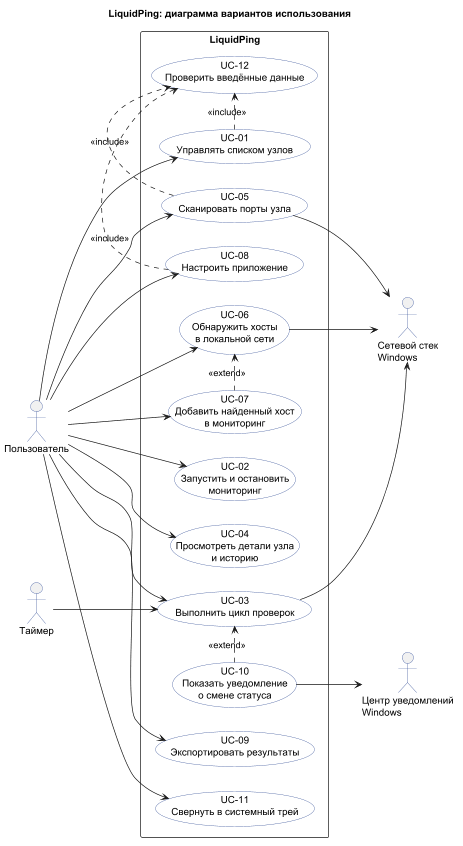

# Модель вариантов использования LiquidPing

Документ описывает актёров и варианты использования (прецеденты) приложения LiquidPing. Он выведен из [SRS](../srs/srs.md) и [SDD](../sdd/sdd.md). Термины определены в [глоссарии](../glossary.md), нефункциональные требования — в [дополнительных спецификациях](../supplementary-spec.md).

## Диаграмма вариантов использования

Исходный код диаграммы: [src/usecase-overview.puml](src/usecase-overview.puml).

Правила построения:
- актёры находятся вне системы, связи между ними не моделируются;
- каждый прецедент инициирован актёром (сплошная стрелка от актёра к прецеденту); для внешней системы, которая только принимает запросы, стрелка идёт от прецедента к актёру;
- прецеденты не соединяются между собой коммуникационной связью; используются только `include` (общее повторяющееся поведение) и `extend` (необязательное расширение).

## Актёры

| Актёр                     | Описание                                                                                                         |
|---------------------------|------------------------------------------------------------------------------------------------------------------|
| Пользователь              | Человек, запускающий проверки, сканирования и обнаружение хостов, управляющий списком узлов и настройками.       |
| Таймер                    | Время как действующее лицо: с заданным интервалом периодически запускает цикл проверок, пока мониторинг включён. |
| Сетевой стек Windows      | Внешняя система: принимает запросы ICMP, TCP, HTTP, DNS и чтения ARP-таблицы и возвращает результаты.            |
| Центр уведомлений Windows | Внешняя система: показывает пользователю уведомления о смене статуса узла.                                       |

## Перечень прецедентов

| ID    | Прецедент                                   | Актёры                              | Связи                           | Требования SRS                      |
|-------|---------------------------------------------|-------------------------------------|---------------------------------|-------------------------------------|
| UC-01 | Управлять списком узлов                     | Пользователь                        | include UC-12                   | REQ-FUNC-001, 002                   |
| UC-02 | Запустить и остановить мониторинг           | Пользователь                        |                                 | REQ-FUNC-008                        |
| UC-03 | Выполнить цикл проверок                     | Пользователь, Таймер, Сетевой стек  |                                 | REQ-FUNC-003…009                    |
| UC-04 | Просмотреть детали узла и историю           | Пользователь                        |                                 | REQ-FUNC-007, 013, 014, 015         |
| UC-05 | Сканировать порты узла                      | Пользователь, Сетевой стек          | include UC-12                   | REQ-FUNC-010…012                    |
| UC-06 | Обнаружить хосты в локальной сети           | Пользователь, Сетевой стек          |                                 | REQ-FUNC-020, 021                   |
| UC-07 | Добавить найденный хост в мониторинг        | Пользователь                        | extend UC-06                    | REQ-FUNC-022                        |
| UC-08 | Настроить приложение                        | Пользователь                        | include UC-12                   | REQ-FUNC-017, REQ-INT-002, 008      |
| UC-09 | Экспортировать результаты                   | Пользователь                        |                                 | REQ-FUNC-018                        |
| UC-10 | Показать уведомление о смене статуса        | Центр уведомлений Windows           | extend UC-03                    | REQ-FUNC-016, REQ-INT-007           |
| UC-11 | Свернуть в системный трей                   | Пользователь                        |                                 | REQ-FUNC-019                        |
| UC-12 | Проверить введённые данные                  | (включается в UC-01, UC-05, UC-08)  |                                 | REQ-SEC-004                         |

## Описание прецедентов

### UC-01 Управлять списком узлов

- **Актёры**: Пользователь.
- **Пояснение**: пользователь добавляет, изменяет и удаляет узлы (домен, IPv4 или IPv6) и выбирает, какие проверки выполнять.
- **Предусловия**: приложение запущено, открыт главный экран.
- **Основной поток**:
  1. Пользователь нажимает «Добавить узел».
  2. Система показывает диалог узла.
  3. Пользователь вводит название и адрес и выбирает проверки: ICMP, TCP (с портом), HTTP(S) (с адресом).
  4. Система проверяет введённые данные (UC-12).
  5. Система сохраняет узел в репозитории (`hosts.json`).
  6. Система показывает узел в списке со статусом Pending.
  7. Вариант использования завершается.
- **Альтернативные потоки**:
  - A1 (изменение): пользователь выбирает узел и «Изменить», шаги 2–7 выполняются для существующего узла.
  - A2 (удаление): пользователь выбирает «Удалить» и подтверждает; система удаляет узел из списка и файла.
  - A3 (отмена): пользователь закрывает диалог, изменений нет.
- **Потоки ошибок**:
  - E1: данные не прошли проверку (UC-12) — система показывает сообщение, диалог остаётся открытым.
  - E2: не удалось записать файл — система показывает сообщение об ошибке, список в памяти сохраняется.
- **Постусловия**: список узлов соответствует выполненному действию и сохранён в `hosts.json`; новый узел включён в проверки.

### UC-02 Запустить и остановить мониторинг

- **Актёры**: Пользователь.
- **Пояснение**: пользователь включает непрерывную проверку всех узлов с заданным интервалом и выключает её.
- **Предусловия**: в списке есть хотя бы один узел.
- **Основной поток**:
  1. Пользователь нажимает «Старт».
  2. Система запускает таймер с интервалом из настроек.
  3. Таймер периодически инициирует UC-03.
  4. Пользователь нажимает «Стоп».
  5. Система останавливает таймер и перестаёт отправлять проверки.
  6. Вариант использования завершается.
- **Альтернативные потоки**:
  - A1: список узлов пуст — кнопка «Старт» недоступна, система предлагает добавить узел.
  - A2: пользователь меняет интервал во время работы — новое значение применяется со следующего цикла.
- **Потоки ошибок**:
  - E1: сеть недоступна — мониторинг продолжается, UC-03 показывает узлы как «Недоступен» и баннер «Нет подключения».
- **Постусловия**: мониторинг находится в состоянии Running (после «Старт») или Idle (после «Стоп»).

### UC-03 Выполнить цикл проверок

- **Актёры**: Таймер (периодически), Пользователь (разовая проверка), Сетевой стек Windows.
- **Пояснение**: система проверяет все узлы по включённым протоколам, оценивает статус и обновляет интерфейс.
- **Предусловия**: в списке есть узлы; запущен мониторинг (Таймер) или пользователь нажал «Проверить».
- **Основной поток**:
  1. Система создаёт задачу проверки для каждого узла (параллельно, не более 64 узлов одновременно).
  2. Каждая задача выполняет включённые проверки ICMP, TCP и HTTP(S) через сетевой стек.
  3. Система получает результаты (успех, задержка, ошибка) и добавляет их в окно из последних 20 циклов.
  4. Система оценивает статус узла (Pending, Available, Unstable, Unavailable).
  5. Система пакетом обновляет интерфейс: статус, задержку, потери, IP-адрес, график и трафик.
  6. Если статус изменился между «Доступен» и «Недоступен», выполняется расширение UC-10.
  7. Вариант использования завершается.
- **Альтернативные потоки**:
  - A1: имя узла не разрешается DNS — результат цикла для узла неуспешный с причиной «DNS».
  - A2: предыдущий цикл ещё не завершён — тик таймера пропускается, наложения циклов нет.
- **Потоки ошибок**:
  - E1: нет сетевого подключения — все узлы получают статус «Недоступен», показывается баннер.
  - E2: проверка превысила таймаут — результат неуспешный с причиной «таймаут».
- **Постусловия**: статусы и метрики узлов актуальны, история пополнена.

### UC-04 Просмотреть детали узла и историю

- **Актёры**: Пользователь.
- **Пояснение**: пользователь открывает подробности выбранного узла: метрики проверок, график задержки и трафик.
- **Предусловия**: в списке есть узел.
- **Основной поток**:
  1. Пользователь выбирает узел в списке (клик 1).
  2. Система показывает панель деталей на вкладке «Обзор»: статус, IP, задержку ICMP, время TCP и HTTP.
  3. Система показывает график задержки за последние N минут и объём трафика проверок.
  4. Пользователь может перейти на вкладку «Порты» (клик 2, UC-05).
  5. Вариант использования завершается.
- **Альтернативные потоки**:
  - A1: узел в состоянии Pending — график пуст, показан индикатор ожидания.
- **Потоки ошибок**: отсутствуют.
- **Постусловия**: на экране отображены данные выбранного узла.

### UC-05 Сканировать порты узла

- **Актёры**: Пользователь, Сетевой стек Windows.
- **Пояснение**: по запросу пользователя система определяет состояние TCP-портов выбранного узла.
- **Предусловия**: выбран узел, открыта вкладка «Порты».
- **Основной поток**:
  1. Пользователь выбирает набор портов: «Популярные», «1–1024» или свой диапазон.
  2. Пользователь нажимает «Сканировать».
  3. Система проверяет введённые данные (UC-12).
  4. Система асинхронно подключается к портам (не более 100 одновременно) с тайм-аутом на каждый порт.
  5. Система показывает прогресс и результаты по мере получения: открыт, закрыт, фильтруется.
  6. По завершении система показывает итоговую сводку.
- **Альтернативные потоки**:
  - A1 (отмена): пользователь нажимает «Отмена»; система прекращает запуск новых соединений за ≤ 2 с и показывает частичный результат.
- **Потоки ошибок**:
  - E1: порты введены некорректно (UC-12) — сообщение, сканирование не запускается.
  - E2: имя узла не разрешается — сообщение, сканирование не запускается.
- **Постусловия**: на экране результаты последнего сканирования; автоматических повторов нет.

### UC-06 Обнаружить хосты в локальной сети

- **Актёры**: Пользователь, Сетевой стек Windows.
- **Пояснение**: по запросу пользователя система находит доступные устройства в IPv4-подсетях собственных сетевых адаптеров.
- **Предусловия**: открыт экран «Локальная сеть», есть активный адаптер с адресом IPv4.
- **Основной поток**:
  1. Пользователь выбирает подсеть и нажимает «Сканировать сеть».
  2. Система определяет подсеть адаптера и проверяет её размер (не более 1024 адресов, префикс не короче /22).
  3. Система проверяет адреса по ICMP (не более 64 одновременно) и показывает прогресс.
  4. Система читает ARP-таблицу и добавляет «тихие» хосты, не ответившие на ICMP.
  5. Система определяет MAC-адрес, производителя (по встроенной базе OUI) и имя хоста (reverse DNS).
  6. Система показывает список: IP, задержка, имя, MAC, производитель.
- **Альтернативные потоки**:
  - A1 (отмена): пользователь нажимает «Отмена», показывается частичный результат.
  - A2: адаптеров несколько — пользователь выбирает подсеть в списке.
- **Потоки ошибок**:
  - E1: подсеть больше /22 — сообщение «Подсеть слишком велика», сканирование не запускается.
  - E2: нет активной сети — сообщение «Нет активной сети».
- **Постусловия**: на экране список найденных хостов; в список мониторинга ничего не добавлено без действия пользователя.

### UC-07 Добавить найденный хост в мониторинг

- **Актёры**: Пользователь.
- **Пояснение**: расширение UC-06: пользователь переносит найденный хост в список мониторинга одним действием.
- **Предусловия**: в результатах обнаружения есть хост.
- **Основной поток**:
  1. Пользователь нажимает «В мониторинг» у хоста.
  2. Система проверяет, нет ли хоста с таким адресом в списке.
  3. Система добавляет хост в репозиторий (имя — имя хоста или IP-адрес).
  4. Система показывает хост на главном экране со статусом Pending.
- **Альтернативные потоки**:
  - A1: хост уже есть в списке — сообщение «Уже в списке», дубликат не создаётся.
- **Потоки ошибок**:
  - E1: не удалось записать файл — сообщение об ошибке.
- **Постусловия**: хост сохранён в `hosts.json` и участвует в мониторинге.

### UC-08 Настроить приложение

- **Актёры**: Пользователь.
- **Пояснение**: пользователь меняет тему, язык, интервал, тайм-ауты, окно графика, уведомления и работу из трея.
- **Предусловия**: приложение запущено.
- **Основной поток**:
  1. Пользователь открывает «Настройки».
  2. Пользователь изменяет значения.
  3. Система проверяет значения (UC-12).
  4. Система применяет изменения без перезапуска и сохраняет их в `settings.json`.
  5. Пользователь закрывает диалог.
- **Альтернативные потоки**:
  - A1: выбрана тема «Системная» — система следует теме Windows.
- **Потоки ошибок**:
  - E1: значение недопустимо (UC-12) — сообщение, значение не применяется.
  - E2: не удалось записать файл — сообщение об ошибке, настройки действуют до закрытия приложения.
- **Постусловия**: настройки применены и сохранены.

### UC-09 Экспортировать результаты

- **Актёры**: Пользователь.
- **Пояснение**: пользователь сохраняет результаты проверок и историю в файл CSV или JSON.
- **Предусловия**: накоплены результаты проверок.
- **Основной поток**:
  1. Пользователь выбирает «Экспорт».
  2. Пользователь выбирает формат и файл.
  3. Система записывает время, узел, статус, задержку и потери.
  4. Система сообщает об успешном сохранении.
- **Альтернативные потоки**:
  - A1: пользователь отменяет выбор файла — экспорт не выполняется.
- **Потоки ошибок**:
  - E1: нет прав на запись или диск недоступен — сообщение об ошибке.
- **Постусловия**: файл создан и содержит данные.

### UC-10 Показать уведомление о смене статуса

- **Актёры**: Центр уведомлений Windows.
- **Пояснение**: расширение UC-03: система сообщает пользователю, что узел стал доступен или недоступен.
- **Предусловия**: уведомления включены в настройках; статус узла изменился между «Доступен» и «Недоступен».
- **Основной поток**:
  1. Система при обработке цикла обнаруживает смену статуса.
  2. Система формирует уведомление (узел и новый статус).
  3. Система передаёт уведомление в Центр уведомлений Windows.
  4. Центр уведомлений показывает уведомление пользователю.
- **Альтернативные потоки**:
  - A1: уведомления выключены — ничего не показывается.
  - A2: повторная смена статуса в пределах одного цикла — показывается одно уведомление.
- **Потоки ошибок**:
  - E1: Центр уведомлений недоступен — событие записывается в журнал.
- **Постусловия**: пользователь уведомлён один раз о каждой смене статуса.

### UC-11 Свернуть в системный трей

- **Актёры**: Пользователь.
- **Пояснение**: приложение скрывается в область уведомлений и продолжает мониторинг.
- **Предусловия**: режим трея включён в настройках.
- **Основной поток**:
  1. Пользователь сворачивает или закрывает окно.
  2. Система скрывает окно, оставляет значок в трее, мониторинг продолжается.
  3. Пользователь нажимает значок в трее.
  4. Система возвращает окно на экран.
- **Альтернативные потоки**:
  - A1: режим трея выключен — закрытие окна завершает приложение.
- **Потоки ошибок**: отсутствуют.
- **Постусловия**: окно скрыто или показано, мониторинг не прерывался.

### UC-12 Проверить введённые данные

- **Актёры**: нет (включается в UC-01, UC-05, UC-08).
- **Пояснение**: общее поведение проверки вводимых значений: имя узла, адрес, порт или диапазон, интервал, тайм-аут.
- **Предусловия**: вызывающий прецедент передал значение и его тип.
- **Основной поток**:
  1. Система проверяет формат значения.
  2. Система проверяет допустимый диапазон.
  3. Система возвращает вызывающему прецеденту признак успеха.
- **Альтернативные потоки**: нет.
- **Потоки ошибок**:
  - E1: значение недопустимо — система возвращает сообщение с указанием допустимого формата или диапазона.
- **Постусловия**: вызывающий прецедент получил результат проверки.
